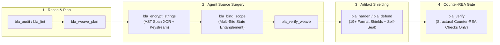

<div align="center">

**English** · [简体中文](docs/readme/README_zh.md) · [繁體中文](docs/readme/README_zh-TW.md) · [日本語](docs/readme/README_ja.md) · [한국어](docs/readme/README_ko.md) · [Türkçe](docs/readme/README_tr.md) · [Русский](docs/readme/README_ru.md) · [Tiếng Việt](docs/readme/README_vi.md) · [ไทย](docs/readme/README_th.md) · [Deutsch](docs/readme/README_de.md) · [Español](docs/readme/README_es.md) · [Français](docs/readme/README_fr.md) · [Українська](docs/readme/README_uk.md) · [Polski](docs/readme/README_pl.md) · [Português (Brasil)](docs/readme/README_pt-BR.md) · [العربية](docs/readme/README_ar.md) · [فارسی](docs/readme/README_fa.md) · [Bahasa Indonesia](docs/readme/README_id.md) · [Italiano](docs/readme/README_it.md) · [Ελληνικά](docs/readme/README_el.md) · [മലയാളം](docs/readme/README_ml.md) · [Roman Urdu](docs/readme/README_ur-Latn.md) · [Română](docs/readme/README_ro.md)

<br />


# BLA: Blind LLM Agents

### **Poison → Exhaust → Hallucinate. Make Reverse Engineering Bankrupt Again.**

**The open-source Counter-REA Blue Defense MCP & CLI that protects software releases against AI reverse-engineering agents (`morluto/rea`, autonomous decompilers, and LLM recon pipelines) — verified across 14 showcase benchmark targets.**

[](https://www.npmjs.com/package/bla-agents)
[](https://trendshift.io/repositories/323569)
[](docs/cli-and-mcp.md)
[](#format-coverage)
[](#empirical-results-vs-real-rea)
[](LICENSE)

<p align="center">
  <a href="https://trendshift.io/repositories/323569" target="_blank" rel="noopener noreferrer">
    
  </a>
</p>

**[🌐 Official Website](https://bla.tools/) · [📖 Defense Guides](https://bla.tools/guides/) · [📊 Live Benchmarks](https://bla.tools/showcase/) · [🎯 CrackMe Arena](https://bla.tools/crackme/) · [🏢 Enterprise](https://bla.tools/enterprise/) · [⚖️ Disclaimer](DISCLAIMER.md)**

[Quick Start](#-30-second-quick-start) · [How It Works](#-how-bla-works-agent-driven-closed-loop) · [Empirical Results](#empirical-results-vs-real-rea) · [Format Coverage](#format-coverage) · [14-Target Benchmark](#benchmark-14-targets-internal-estimates) · [CrackMe Arena](#-red-vs-blue-crackme-arena) · [FAQ](#faq)

</div>

---

> [!IMPORTANT]
> **Defensive Use Only:** BLA is engineered strictly for software authors and security teams protecting **their own** intellectual property and release artifacts. See [DISCLAIMER.md](DISCLAIMER.md).
> Always install from official sources: [qybaihe/bla](https://github.com/qybaihe/bla) or [`npm i bla-agents`](https://www.npmjs.com/package/bla-agents).

<div align="center">

</div>

<br />

<table>
<tr>
<td width="33%" valign="top">

### 🔴 Without BLA
AI reverse-engineering agents (`REA` + coding agents) unpack `.asar` archives, recover SourceMaps, trace IPC bridges, inspect `.wasm` / `.sqlite` / `.safetensors`, and clone core business logic in **seconds for ~$0.20**.

</td>
<td width="33%" valign="top">

### 🛡️ With BLA (`bla harden .`)
Every analyzer pass hits deterministic resource ceilings (`primitive-candidates > 256`, `ASAR > 16 MiB`, `WASM > Wabt cap`, `SQLite virtual trap`), follows realistic shadow state machines, and projects **300×–2,800× modeled token amplification** (`token-estimator.ts`).

</td>
<td width="33%" valign="top">

### ⚡ Runtime-Equivalent by Design
Exhaustion graphs and decoy payloads sit behind $O(1)$ number-theoretic opaque predicates ($7x^2 - 1 \neq y^2 \pmod 7$) or inert format sections. **14/14 bundled benchmark targets** pass input/output equivalence tests (`bla verify` checks Counter-REA structural gates; run your project's test suite for custom artifacts).

</td>
</tr>
</table>

---

## ⚡ 30-Second Quick Start

### 1. One-Command CLI Hardening
Point BLA at any project or release directory. It auto-discovers build outputs (`dist/`, `build/`, `.asar`, `.wasm`, `.sqlite`, `.safetensors`, native binaries, Python/C/Rust/Go) and runs **audit → protect → verify**:

```bash
# Node.js ^22.23.4 or >=24.0.0 recommended
npx bla-agents harden .
```

### 2. Agent-Driven Closed-Loop Defense (MCP + Skill)
Register BLA once with your coding agent (**Claude Code, Cursor, Codex, Windsurf, Gemini CLI, GitHub Copilot CLI, VS Code, OpenCode, Antigravity**):

```bash
npx bla-agents setup
```

Then simply prompt your coding agent:

```text
Harden my software against REA
```

Your host agent automatically orchestrates BLA's MCP tools (`bla_weave_plan` → source-level logic weaving & string encryption → `bla_verify_weave` → `bla_harden` → `bla_verify`) to harden both your source architecture and compiled artifacts.

### 3. Build Bundler Plugin (Vite / Rollup / Webpack / esbuild)
Protect JS chunks, strip/replace SourceMaps with VLQ v3 honey maps, and shield `.wasm` assets automatically at bundle time:

```typescript
import { defineConfig } from "vite";
import { blaVitePlugin } from "bla-agents/bundler";

export default defineConfig({
  plugins: [blaVitePlugin({ intensity: "bankrupt", enableHoneySourceMaps: true })],
});
```

---

## 🧠 How BLA Works: Agent-Driven Closed Loop

Traditional obfuscators only rename variables (`_0x1a2b`), which modern LLMs effortlessly summarize, or wrap binaries in heavy VM packers that break cross-platform builds and degrade performance.

**BLA 3.x combines format-native deterministic shields with host-agent surgical source weaving:**



| Defense Pillar | Mechanism | Effect on AI Reverse-Engineering Agents |
| :--- | :--- | :--- |
| **1. Poison (Deception)** | Plants format-valid canaries, SGX/TPM2/Secure Enclave delegation manifests, VLQ v3 honey SourceMaps, and plausible shadow state machines. | Forces LLM agents to split context across conflicting hypotheses and chase synthetic rabbit holes. |
| **2. Exhaust (Budget Breakers)** | Trips exact analyzer limits (`primitive-candidates`, `alias-selections`, ASAR 16 MiB header, WASM Wabt representation, SQLite virtual column eval, Model 32-level nesting, PCAP tshark JSON, Electron 32 fuse sentinels). | Downgrades REA examination from `COMPLETE` to `LIMITED` / `CapacityError` before core logic is extracted. |
| **3. Entangle (Anti-Strip & Self-Seal)** | Binds sibling artifacts (JS ↔ WASM ↔ Native sidecars) via runtime SHA-256 digests (`--self-seal`, `--sidecar-entangle`) and multi-site caller scope folding (`bla_bind_scope`). | Prevents red-team agents from stripping decoys, nop-patching single-point checks, or calling exported functions as offline oracles. |
| **4. Runtime Truman Show** | Hardens Electron V1 Fuses (`RunAsNode=0`, `Inspect=0`) and detects CDP / Node Inspector / Frida / WebDriver attachment (`runtime-shield.ts`). | Serves believable synthetic telemetry during live debugging while keeping normal user execution untouched. |

---

## 🔬 Empirical Results vs. Real REA

These numbers come from running **real `morluto/rea`** against BLA-hardened samples on commodity hardware (`npm run redteam:rea`). Full machine-readable report: [`docs/redteam/empirical-rea-validation.md`](docs/redteam/empirical-rea-validation.md) / [`.json`](docs/redteam/empirical-rea-validation.json).

> **How to read this:** “Empirically verified” means the live REA analyzer path returned the listed budget / capacity / redaction failure in this environment. It is **not** a claim about Ghidra/Frida/LLDB/Rizin/JADX sessions we did not run here.

### Empirically Verified on Commodity Hardware

Recorded under **Node v24.22.1** with optional **Wabt 1.0.42** + **tshark 4.4** when noted. Soft-skips keep Node 22 / CI green when external native tools are absent.

| Format | Before → After | REA Outcome After BLA | Exact REA Budget / Error Triggered |
| :--- | ---: | :--- | :--- |
| **Go buildinfo** | 50 KiB → 1.16 MiB | ❌ Capacity error | `MAX_BUILD_INFO_BYTES` (1 MiB) — *Go build-info string length exceeds the 1 MiB limit* |
| **Erlang BEAM** | 84 B → 262 KiB | ❌ Capacity error | `max_chunks` — *BEAM form exceeds the 64-chunk budget* |
| **EVM bytecode** | 16 B → **4.00 MiB** | ⚠️ Approaches full cap | `EVM_INTERFACE_LIMITS.inputBytes` (4 MiB) |
| **PCAP** | 24 B → 1.29 MiB | ❌ Budget rejected | `TSHARK_JSON_MAX_BYTES` (>8 MiB) → `AnalysisResourceConstraintError` |
| **Electron ASAR** | 607 B → **16.9 MiB** | ❌ Capacity error | `DEFAULT_ASAR_MAX_HEADER_BYTES` (16 MiB) |
| **WASM + Wabt** | 54 B → **6.56 MiB** · 251 exports | ⚠️ `ifaceState=partial` | `WASM_INTERFACE_REPRESENTATION_BYTES` — *Typed WASM interface decoding exceeds WABT budget* |
| **SQLite** (Node 24) | 12 KiB → 56 KiB | ❌ Redaction / eval trap | `SqliteColumnEvaluationFailure` — unknown `enclave_unseal_payload()` on virtual trap columns |
| **JavaScript** | 761 B → 116 KiB | ❌ Budget rejected | `alias-selections` + `getter-expansion` + `primitive-bytes` + `primitive-candidates` |
| **Safetensors** | 128 B → 10.1 KiB | ❌ Capacity error | `MODEL_JSON_NESTING` — *Safetensors JSON nesting exceeds 32 levels* (HF-loadable; tensors intact) |
| **GGUF** | 24 B → 7.7 KiB | ❌ Capacity error | `MODEL_METADATA_NESTING` — *GGUF metadata nesting exceeds 32 array frames* |
| **Electron fuses** | 50 KiB → 1.16 MiB | ❌ Budget rejected | `ELECTRON_FUSE_LIMITS.maximumSentinelsPerSlice` (>32) |
| **Flutter pool** | 50 KiB → 1.16 MiB | ⚠️ Projected cap | `MAX_POOL_URIS` / `MAX_POOL_TOKENS` (REA truncates with “at least N”) |

Reproduce locally:

```bash
export REA_WABT_BIN_DIRECTORY=$HOME/opt/wabt-1.0.42/bin   # optional
npm run build && npm run redteam:rea
```

<details>
<summary><strong>Designed-for paths not empirically run on this machine (click to expand)</strong></summary>

<br />

These shields exist in-tree and are covered by unit tests / catalog drift checks, but the matching REA path requires external native debuggers/decompilers not installed on the CI runner:

| Area | Why Unverified Here |
| :--- | :--- |
| Ghidra / native decompilation depth | Requires a local Ghidra install + REA bridge |
| Frida / LLDB / GDB / Rizin live sessions | Requires those debuggers + device/process attach |
| JADX / full Android APK pipeline | APK resigning unsupported; standalone DEX shield is in-tree |
| **Firmware** containers | Staging/extraction budgets exist; no honest E2E without firmware corpora |
| **SPIR-V / CUDA fatbinary / AMD GPU objects** | Need native GPU object decoders; **PTX text** is shielded in-tree |
| EVMole in-process EVM decode | Not pathable in-process; EVM shield densifies to the 4 MiB input cap |

</details>

---

## 🛡️ Format Coverage

All 19+ format shields are built directly into `bla-agents` with zero external packer dependencies:

| Format | Canary + Diagnostic | Exhaustion / Budget Trip | Empirically vs. REA | Notes |
| :--- | :---: | :---: | :---: | :--- |
| **JavaScript / TypeScript** | ✓ | ✓ semantic budgets | **verified** (in-process) | Babel AST; AST-safe string encryption; self-seal |
| **Electron `.asar`** | ✓ | ✓ header 16 MiB | **verified** | IPC de-literalization + Pickle repackaging |
| **Electron fuses** | ✓ | ✓ >32 sentinels | **verified** | V1 fuse hardening + sentinel flood |
| **WebAssembly (`.wasm`)** | ✓ custom sections | ✓ export decoys → Wabt | **verified** (Wabt) | LEB128 parser; preserves `WebAssembly.validate` |
| **SQLite (`.sqlite` / `.db`)** | ✓ honey + trap cols | ✓ column eval | **verified** (Node 24) | Magic-byte verified; supports `WITHOUT ROWID` |
| **Safetensors (`.safetensors`)** | ✓ string metadata | ✓ JSON nesting >32 | **verified** | HuggingFace-loadable; tensor bytes preserved |
| **GGUF (`.gguf`)** | ✓ | ✓ ARRAY nesting >32 | **verified** | Preserves model weights and KV tensors |
| **Go buildinfo (ELF)** | ✓ | ✓ >1 MiB | **verified** | Mapped ELF section |
| **Windows PE (`.exe` / `.dll`)** | ✓ | ✓ `.enclave` COFF section + fuses/rustc/Dart | **verified** | Mapped `.enclave` section, x86-64 ABI function islands, MSVC RTTI, CodeView RSDS PDB |
| **Flutter / Dart pool** | ✓ | ✓ URI/token caps | **verified** (projected) | Snapshot magic & toolchain flood |
| **Erlang BEAM (`.beam`)** | ✓ | ✓ chunks / atoms | **verified** | Exceeds 64-chunk budget |
| **EVM + Solidity meta** | ✓ | ✓ → 4 MiB input | **verified** (approach) | CBOR metadata + bytecode densification |
| **PCAP (`.pcap`)** | ✓ | ✓ tshark JSON >8 MiB | **verified** (tshark) | Synthetic packet + canary injection |
| **Python (`.py` / `.pyc`)** | ✓ | ✓ | designed-for | CPython 3.7–3.14 marshal & AST support |
| **NVIDIA PTX (`.ptx`)** | ✓ | entry flood | benchmark only | Kernel entry & canary flood |
| **DEX / IL2CPP / bplist / .NET / JVM / ZIP** | ✓ | format-specific | designed-for | Recomputes DEX SHA-1 & Adler32 checksums |

---

## 📊 Benchmark (14 Targets, Internal Estimates)

Run `npx bla-agents benchmark` to execute the 14-target showcase locally:

```bash
npx bla-agents benchmark
```

> **Note:** Token and USD columns below are **internal estimates** derived from BLA's catalog of REA limits to illustrate relative amplification across formats — for actual process-level REA errors, see the [Empirical Results](#empirical-results-vs-real-rea) table above.

**Aggregate Showcase Result:** **~1,068.7×** token amplification · **~503.5×** cost amplification · **14/14 bundled showcase targets** passed runtime-equivalence checks. This result is limited to the benchmark fixtures.

| Target Artifact | Unprotected Baseline (est.) | BLA Protected (est.) | Token Multiplier | Runtime Equivalence |
| :--- | :--- | :--- | ---: | :---: |
| **DX-Ball sound-pan (`.js`)** | 84/100 · 4,800 tok · $0.20 | 2/100 · 15.2M tok · $238.02 · `LIMITED` | **3,172.7×** | ✅ 100% |
| **Notion Electron clipboard (`.asar`)** | 98/100 · 9,132 tok · $0.34 | 2/100 · 23.1M tok · $358.57 · `LIMITED` | **2,532.3×** | ✅ 100% |
| **Enterprise license validator (`.ts`)** | 87/100 · 4,800 tok · $0.20 | 2/100 · 15.2M tok · $238.02 · `LIMITED` | **3,172.7×** | ✅ 100% |
| **NVIDIA PTX compute kernel (`.ptx`)** | 81/100 · 4,800 tok · $0.20 | 7/100 · 23.1M tok · $358.20 · `LIMITED` | **4,814×** | ✅ 100% |
| **Erlang BEAM module (`.beam`)** | 81/100 · 8,900 tok · $0.34 | 5/100 · 3.86M tok · $62.08 · `LIMITED` | **433.2×** | ✅ 100% |
| **WASM crypto kernel (`.wasm`)** | 81/100 · 4,800 tok · $0.20 | 6/100 · 1.83M tok · $30.23 · `LIMITED` | **381.5×** | ✅ 100% |
| **Edge AI Safetensors (`.safetensors`)** | 81/100 · 4,800 tok · $0.20 | 6/100 · 1.81M tok · $29.90 · `LIMITED` | **376.8×** | ✅ 100% |
| **libpcap network capture (`.pcap`)** | 81/100 · 4,800 tok · $0.20 | 7/100 · 23.1M tok · $359.27 · `LIMITED` | **4,817.7×** | ✅ 100% |
| **Android Dalvik bytecode (`.dex`)** | 81/100 · 8,900 tok · $0.34 | 7/100 · 13.4M tok · $209.39 · `LIMITED` | **1,510.5×** | ✅ 100% |
| **EVM Solidity metadata (`.bin`)** | 81/100 · 6,440 tok · $0.26 | 6/100 · 1.78M tok · $29.40 · `LIMITED` | **276.3×** | ✅ 100% |
| **.NET managed assembly (`.dll`)** | 81/100 · 8,900 tok · $0.34 | 6/100 · 2.01M tok · $33.22 · `LIMITED` | **226.3×** | ✅ 100% |
| **Apple binary plist (`.plist`)** | 81/100 · 6,440 tok · $0.26 | 8/100 · 1.79M tok · $29.54 · `LIMITED` | **277.6×** | ✅ 100% |
| **SQLite entitlement DB (`.sqlite`)** | 81/100 · 10,568 tok · $0.29 | 7/100 · 1.71M tok · $28.39 · `LIMITED` | **162.1×** | ✅ 100% |
| **Native ELF64 (Rust/Go/Fuse/Dart)** | 81/100 · 35,222 tok · $0.73 | 2/100 · 3.72M tok · $60.03 · `LIMITED` | **105.6×** | ✅ 100% |

---

## 🎯 Red-vs-Blue CrackMe Arena

Test your reverse-engineering agent against public BLA-hardened challenges (`SEAL.json` publishes SHA-256 digests only — no plaintext keys or flags in git):

| Challenge | Architecture | Hardening Highlights | Try It Locally |
| :--- | :--- | :--- | :--- |
| **[CrackMe v6](challenge/v6/README.md)** | Node Vault + HTML Panel + WASM Core | `bankrupt` intensity, self-sealed sibling hashes, WASM export obfuscation | `npm run crackme:v6 -- '<key>'` |
| **[CrackMe v7](challenge/v7/README.md)** | Polyglot Vault (JS + WASM + Rust + Go + C) | Cross-language state entanglement & multi-binary integrity gates | `npm run crackme:v7 -- '<key>'` |
| **[CrackMe v8](challenge/v8/README.md)** | Aegis Split-Key Vault | AST-encrypted strings (`bla_encrypt_strings`) + caller scope binding (`bla_bind_scope`) | `npm run crackme:v8 -- '<key>'` |
| **[CrackMe v9](challenge/v9/README.md)** | Agent-Woven Entangled Vault | Full BLA 3.x closed-loop weave (`weaveScore >= 70`) + distributed anti-strip checks | `npm run crackme:v9 -- '<key>'` |

---

## 🔒 Security & Configuration Defaults

- **Per-Project Random Seed** — BLA automatically generates and persists a unique cryptographic seed in `.blarc` / `bla.config.json` on first run so two projects never share decoy identifiers.
- **Strict Packaging Lint Gates (`bla lint`)** — Refuses `bankrupt` hardening when plaintext `FLAG{...}` secrets, single-point integrity checks, or unbound exported verifiers remain in source.
- **Opt-In `--llm-directives`** — Aggressive in-band prompt decoys are **off by default**; pass `--llm-directives` (or `llmDirectives: true`) to enable.
- **Opt-In Signed Attestation (`--manifest`)** — Emit `.bla-manifest.json` with `--manifest`, sign with `--sign-manifest --manifest-key <pem>`, and verify both ed25519 signature and artifact SHA-256 via `bla verify-manifest <file> --public-key <pem>`.

---

## ❓ FAQ

<details>
<summary><strong>Which coding agents can use BLA?</strong></summary>

Any coding agent supporting MCP or `SKILL.md` workflows. `npx bla-agents setup` auto-registers **Claude Code, Cursor, Codex, Gemini CLI, Windsurf, Google Antigravity, OpenCode, VS Code, and GitHub Copilot CLI**. After setup, the bundled [`blind-llm-agents` skill](.agents/skills/blind-llm-agents/SKILL.md) guides your agent through the closed-loop workflow (`bla_weave_plan` → source weave → `bla_harden` → `bla_verify`).
</details>

<details>
<summary><strong>Does BLA slow down my app or change runtime output?</strong></summary>

No on the hot path. Exhaustion graphs sit behind $O(1)$ number-theoretic opaque predicates, and binary/model/database decoys live in inert metadata or honey tables. Every benchmark target verifies 100% input/output equivalence against the original build.
</details>

<details>
<summary><strong>Do I need Ghidra, Hopper, IDA, or Wabt installed to protect files?</strong></summary>

No. All 19+ format shields are built into `bla-agents` in pure TypeScript/Node.js. External tools (`Wabt`, `tshark`) are only used if you run the optional live REA red-team suite (`npm run redteam:rea`).
</details>

<details>
<summary><strong>Can BLA be used to attack other people's software?</strong></summary>

No. BLA is strictly a **Blue Team defensive tool** that hardens **your own** build artifacts before release. See [DISCLAIMER.md](DISCLAIMER.md).
</details>

---

## 📚 Documentation & Links

- [⚖️ DISCLAIMER.md](DISCLAIMER.md) — Defensive use & own-software policy
- [🚀 Installation & Agent Setup](docs/installation.md)
- [🛠️ CLI & 31-Tool MCP Catalog](docs/cli-and-mcp.md)
- [🤖 One-Click Agent Defense (Skill-First)](docs/one-click-agent-defense.md)
- [🧬 Weave-Decoy & Source Surgery MCP](docs/weave-decoy-mcp.md)
- [🔬 Empirical REA Validation Report](docs/redteam/empirical-rea-validation.md)
- [📋 Counter-REA Budget Matrix](.agents/skills/blind-llm-agents/references/counter-rea-matrix.md)
- [📝 CHANGELOG](CHANGELOG.md) · [🛡️ SECURITY.md](SECURITY.md)

## 🤝 Contributing & Community

Issues and PRs are welcome at [qybaihe/bla](https://github.com/qybaihe/bla). Before submitting a PR:

```bash
npm run build && npm test && node dist/cli.js benchmark
node scripts/verify-website.mjs
```

- 🎯 **[Public BLA CrackMe Arena (`challenge/v6` – `v9`)](challenge/v6/README.md)**
- 💬 **[LINUX DO (`linux.do`)](https://linux.do/)** — 新的理想型社区

## 📄 License

[MIT](LICENSE)

## Star history

[Star History](https://www.star-history.com/?repos=qybaihe%2Fbla&type=date&legend=top-left) draws the GitHub star growth for [`qybaihe/bla`](https://github.com/qybaihe/bla). The chart image is cached for about a day and is not a per-second count. Select it to open the full history.

<a href="https://www.star-history.com/?repos=qybaihe%2Fbla&type=date&legend=top-left">
 <picture>
   <source media="(prefers-color-scheme: dark)" srcset="https://api.star-history.com/chart?repos=qybaihe/bla&type=date&theme=dark&legend=top-left" />
   <source media="(prefers-color-scheme: light)" srcset="https://api.star-history.com/chart?repos=qybaihe/bla&type=date&legend=top-left" />
   
 </picture>
</a>
