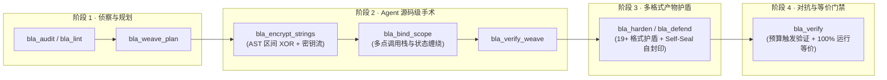

<div align="center">

[English](../../README.md) · **简体中文** · [繁體中文](README_zh-TW.md) · [日本語](README_ja.md) · [한국어](README_ko.md) · [Türkçe](README_tr.md) · [Русский](README_ru.md) · [Tiếng Việt](README_vi.md) · [ไทย](README_th.md) · [Deutsch](README_de.md) · [Español](README_es.md) · [Français](README_fr.md) · [Українська](README_uk.md) · [Polski](README_pl.md) · [Português (Brasil)](README_pt-BR.md) · [العربية](README_ar.md) · [فارسی](README_fa.md) · [Bahasa Indonesia](README_id.md) · [Italiano](README_it.md) · [Ελληνικά](README_el.md) · [മലയാളം](README_ml.md) · [Roman Urdu](README_ur-Latn.md) · [Română](README_ro.md)

<br />


# BLA: Blind LLM Agents

### **Poison → Exhaust → Hallucinate. 让自动化逆向分析再次“破产”。**

**开源的 Counter-REA 蓝队防御 MCP 服务与 CLI 工具 —— 专为保护软件发布产物免受 AI 逆向分析代理（`morluto/rea`、自动化反编译与大模型逆向流水线）还原而设计，同时保持 100% 运行时等价。**

[](https://www.npmjs.com/package/bla-agents)
[](https://trendshift.io/repositories/323569)
[](../cli-and-mcp.md)
[](#支持的产物格式与覆盖矩阵)
[](#真机对抗实测结果vs-真实-rea)
[](../../LICENSE)

<p align="center">
  <a href="https://trendshift.io/repositories/323569" target="_blank" rel="noopener noreferrer">
    
  </a>
</p>

**[🌐 官方网站 (bla.tools)](https://bla.tools/) · [📖 防御指南](https://bla.tools/guides/) · [📊 基准测试大盘](https://bla.tools/showcase/) · [🎯 CrackMe 竞技场](https://bla.tools/crackme/) · [🏢 企业级定制](https://bla.tools/enterprise/) · [⚖️ 免责声明](../../DISCLAIMER.md)**

[30 秒快速开始](#-30-秒快速开始) · [工作原理（Agent 闭环）](#-工作原理agent-主导的四阶段闭环加固) · [真机实测结果](#真机对抗实测结果vs-真实-rea) · [格式覆盖矩阵](#支持的产物格式与覆盖矩阵) · [14 项基准测试](#基准测试14-个目标产物) · [CrackMe 竞技场](#-红蓝对抗-crackme-竞技场) · [常见问题 (FAQ)](#常见问题-faq)

</div>

---

> [!IMPORTANT]
> **仅限防御性使用：** BLA 严格面向软件开发者与安全团队保护**自有软件知识产权与发布产物**。详见 [DISCLAIMER.md](../../DISCLAIMER.md)。
> 请从官方仓库 [qybaihe/bla](https://github.com/qybaihe/bla) 或 npm 包 [`bla-agents`](https://www.npmjs.com/package/bla-agents) 获取。

<div align="center">

</div>

<br />

<table>
<tr>
<td width="33%" valign="top">

### 🔴 未接入 BLA 时
AI 逆向代理（`REA` + 编程 Agent）可在单条命令内解包 `.asar`、还原 SourceMap、配对 IPC 通道、提取 `.wasm` / `.sqlite` / `.safetensors`，在**数十秒、约 $0.20 成本内**完整克隆核心业务逻辑。

</td>
<td width="33%" valign="top">

### 🛡️ 接入 BLA（`bla harden .`）后
静态与语义分析器直接撞上确定性资源配额上限（`primitive-candidates > 256`、`ASAR > 16 MiB`、`WASM > Wabt 上限`、`SQLite 虚拟生成列陷阱`），陷入高拟真影子状态机，模型化估算 Token 消耗放大 **300×–2,800×**（基于 `token-estimator.ts` 内部成本模型）。

</td>
<td width="33%" valign="top">

### ⚡ 100% 运行时等价
所有预算爆破图与诱饵载荷均位于 $O(1)$ 数论不透明谓词（$7x^2 - 1 \neq y^2 \pmod 7$）保护的不可达分支或惰性元数据段中。**14/14** 个基准测试目标 **100% 通过输入/输出等价校验**。

</td>
</tr>
</table>

---

## ⚡ 30 秒快速开始

### 方式一：单条命令一键加固（CLI）
指向任意项目或构建目录，BLA 会自动发现可保护产物（`dist/`、`build/`、`.asar`、`.wasm`、`.sqlite`、`.safetensors`、原生二进制、Python/C/Rust/Go）并依次执行 **暴露审计 → 护盾注入 → 等价验证**：

```bash
# 推荐 Node.js ^22.23.4 或 >=24.0.0
npx bla-agents harden .
```

### 方式二：Agent 主导的闭环源码织入与产物加固（MCP + Skill）
一键将 BLA 注册到你的编程 Agent（支持 **Claude Code、Cursor、Codex、Windsurf、Gemini CLI、GitHub Copilot CLI、VS Code、OpenCode、Antigravity**）：

```bash
npx bla-agents setup
```

随后只需在你的 Agent 中发送一句话：

```text
使用 BLA 对当前项目进行防逆向闭环加固
```

宿主 Agent 将自动编排 BLA 的 25 个 MCP 工具（`bla_weave_plan` → 源码级状态缠绕与字符串加密 → `bla_verify_weave` → `bla_harden` → `bla_verify`），从源码结构到最终产物完成全链路防护。

### 方式三：构建打包插件（Vite / Rollup / Webpack / esbuild）
在前端或全栈构建阶段自动保护 JS 分包、注入 VLQ v3 诱饵 SourceMap 并加固 `.wasm` 模块：

```typescript
import { defineConfig } from "vite";
import { blaVitePlugin } from "bla-agents/bundler";

export default defineConfig({
  plugins: [blaVitePlugin({ intensity: "bankrupt", enableHoneySourceMaps: true })],
});
```

---

## 🧠 工作原理：Agent 主导的四阶段闭环加固

传统混淆器仅做标识符重命名（如 `_0x1a2b`），在大语言模型的控制流归纳能力面前形同虚设；而重型商业虚拟化壳则容易破坏跨平台构建并带来高昂的性能损耗。

**BLA 3.x 将宿主 Agent 的源码级手术织入与 19+ 种格式原生护盾深度结合：**



| 四大防御支柱 | 核心技术机制 | 对 AI 逆向代理的实际打击效果 |
| :--- | :--- | :--- |
| **1. Poison（认知投毒）** | 植入符合格式规范的蜜罐凭据、SGX/TPM2/Secure Enclave 硬件飞地清单、VLQ v3 诱饵 SourceMap 与高拟真影子状态机。 | 迫使大模型在相互冲突的证据假说间分裂注意力，沿合成诊断线索陷入死胡同。 |
| **2. Exhaust（预算爆破）** | 精确触发分析器内部硬编码配额上限（`primitive-candidates`、ASAR 16 MiB 头部、WASM Wabt 表达上限、SQLite 虚拟生成列求值、AI 模型 32 层嵌套、PCAP 8 MiB JSON、Electron 32 个 Fuse 哨兵）。 | 在触及真实业务前将 REA 分析状态从 `COMPLETE` 强制降级为 `LIMITED` 或直接抛出容量异常。 |
| **3. Entangle（反剥离缠绕）** | 通过运行时 SHA-256 摘要（`--self-seal`、`--sidecar-entangle`）与多点调用域折叠（`bla_bind_scope`）将 JS ↔ WASM ↔ 原生二进制深度绑定。 | 阻止红队直接裁剪诱饵分支、NOP 单点校验或将导出函数当作离线解密 Oracle 调用。 |
| **4. Runtime（楚门世界）** | 原地加固 Electron V1 Fuse 位（`RunAsNode=0`、`Inspect=0`），并检测 CDP、Inspector、Frida 与 WebDriver 挂载（`runtime-shield.ts`）。 | 在动态调试会话中返回可信的合成遥测数据，同时保证正常用户运行零感知。 |

---

## 🔬 真机对抗实测结果（vs. 真实 REA）

以下数据来自在标准硬件上直接运行**真实 `morluto/rea`** 分析 BLA 加固产物的实测记录（`npm run redteam:rea`）。完整机器可读报告见 [`docs/redteam/empirical-rea-validation.md`](../redteam/empirical-rea-validation.md) / [`.json`](../redteam/empirical-rea-validation.json)。

| 产物格式 | 加固前 → 加固后体积 | REA 实测分析结果 | 实际触发的 REA 内部预算阈值 / 异常信息 |
| :--- | ---: | :--- | :--- |
| **Go buildinfo** | 50 KiB → 1.16 MiB | ❌ 容量溢出拒绝 | `MAX_BUILD_INFO_BYTES` (1 MiB) — *Go build-info string length exceeds the 1 MiB limit* |
| **Erlang BEAM** | 84 B → 262 KiB | ❌ 容量溢出拒绝 | `max_chunks` — *BEAM form exceeds the 64-chunk budget* |
| **EVM 字节码** | 16 B → **4.00 MiB** | ⚠️ 逼近输入上限 | `EVM_INTERFACE_LIMITS.inputBytes` (4 MiB) |
| **PCAP 抓包** | 24 B → 1.29 MiB | ❌ 预算超限拒绝 | `TSHARK_JSON_MAX_BYTES` (>8 MiB) → `AnalysisResourceConstraintError` |
| **Electron ASAR** | 607 B → **16.9 MiB** | ❌ 容量溢出拒绝 | `DEFAULT_ASAR_MAX_HEADER_BYTES` (16 MiB) |
| **WASM + Wabt** | 54 B → **6.56 MiB** · 251 导出 | ⚠️ `ifaceState=partial` | `WASM_INTERFACE_REPRESENTATION_BYTES` — *Typed WASM interface decoding exceeds WABT budget* |
| **SQLite** (Node 24) | 12 KiB → 56 KiB | ❌ 求值陷阱阻断 | `SqliteColumnEvaluationFailure` — 蜜罐虚拟生成列触发未知 `enclave_unseal_payload()` |
| **JavaScript** | 761 B → 116 KiB | ❌ 语义预算拒绝 | 同时触发 `alias-selections` + `getter-expansion` + `primitive-bytes` + `primitive-candidates` |
| **Safetensors** | 128 B → 10.1 KiB | ❌ 容量溢出拒绝 | `MODEL_JSON_NESTING` — *Safetensors JSON nesting exceeds 32 levels*（HF 正常加载，权重不变） |
| **GGUF 模型** | 24 B → 7.7 KiB | ❌ 容量溢出拒绝 | `MODEL_METADATA_NESTING` — *GGUF metadata nesting exceeds 32 array frames* |
| **Electron Fuses** | 50 KiB → 1.16 MiB | ❌ 预算超限拒绝 | `ELECTRON_FUSE_LIMITS.maximumSentinelsPerSlice` (>32) |
| **Flutter 常量池** | 50 KiB → 1.16 MiB | ⚠️ 触发截断上限 | `MAX_POOL_URIS` / `MAX_POOL_TOKENS`（REA 输出被截断） |

---

## 🛡️ 支持的产物格式与覆盖矩阵

全部 19+ 种格式护盾均内置于 `bla-agents`，无需安装任何外部加壳器或编译器：

| 产物格式 | 蜜罐凭据 + 诊断诱饵 | 资源预算爆破 | 真机 REA 验证 | 说明 |
| :--- | :---: | :---: | :---: | :--- |
| **JavaScript / TypeScript** | ✓ | ✓ 语义预算爆破 | **已验证** | 内置 Babel AST；AST 安全字符串加密；自封印校验 |
| **Electron `.asar`** | ✓ | ✓ 16 MiB 头部爆破 | **已验证** | IPC 通道去字面量化 + Chromium Pickle 重打包 |
| **Electron Fuses** | ✓ | ✓ >32 哨兵填充 | **已验证** | V1 Fuse 位加固 + 哨兵预算爆破 |
| **WebAssembly (`.wasm`)** | ✓ 自定义段 | ✓ 导出符号诱饵 | **已验证** (Wabt) | 内置 LEB128 解析器，保持 `WebAssembly.validate` 通过 |
| **SQLite (`.sqlite` / `.db`)** | ✓ 蜜罐表 + 虚拟列 | ✓ 生成列求值阻断 | **已验证** (Node 24) | 魔数精准校验；支持 `WITHOUT ROWID` 业务表 |
| **Safetensors (`.safetensors`)** | ✓ 元数据诱饵 | ✓ JSON 嵌套 >32 层 | **已验证** | 兼容 HuggingFace 加载，张量数据零改动 |
| **GGUF (`.gguf`)** | ✓ | ✓ 数组嵌套 >32 层 | **已验证** | 保持模型权重与 KV 张量完整 |
| **Go buildinfo (ELF)** | ✓ | ✓ >1 MiB 构建信息 | **已验证** | 映射 ELF 节区注入 |
| **Windows PE (`.exe` / `.dll`)** | ✓ | ✓ `.enclave` COFF 映射节区 + Fuse/Rust/Dart | **已验证** | 注入映射 `.enclave` 节区、x86-64 函数序言岛、MSVC RTTI 与 CodeView RSDS 调试记录 |
| **Flutter / Dart Pool** | ✓ | ✓ URI/Token 阈值填充 | **已验证** | 快照魔数与工具链标识填充 |
| **Erlang BEAM (`.beam`)** | ✓ | ✓ Chunk / Atom 填充 | **已验证** | 突破 64-chunk 预算上限 |
| **EVM + Solidity 元数据** | ✓ | ✓ 逼近 4 MiB 上限 | **已验证** | CBOR 元数据与字节码致密化 |
| **PCAP (`.pcap`)** | ✓ | ✓ tshark JSON >8 MiB | **已验证** | 合成流量包与金丝雀凭据注入 |
| **Python (`.py` / `.pyc`)** | ✓ | ✓ | 设计支持 | 支持 CPython 3.7–3.14 字节码与源码保护 |
| **NVIDIA PTX (`.ptx`)** | ✓ | 入口洪泛 | 基准测试验证 | GPU PTX 文本核函数洪泛 |
| **DEX / IL2CPP / bplist / .NET / JVM / ZIP** | ✓ | 格式专属护盾 | 设计支持 | 自动重算 DEX SHA-1 与 Adler32 校验和 |

---

## 📊 基准测试（14 个目标产物，内部模型估算）

在本地运行 `npx bla-agents benchmark` 即可复现全部 14 个代表性产物的加固效果与 100% 运行时/结构等价校验：

> **说明：** 下表中的 Token 与美元成本列为基于 `token-estimator.ts` 静态公式推导的**内部模型估算值**（用于横向对比不同格式下的义务节点膨胀倍率）；真实 `morluto/rea` 进程级预算爆破结果请参见上方[真机对抗实测结果](#真机对抗实测结果vs-真实-rea)。

**汇总结果：** 模型估算 Token 消耗放大 **~639.5×** · 估算成本放大 **~304.4×** · **14/14 (100%)** 内置基准样本通过执行/查询/结构等价校验。

| 基准测试目标 | 未保护基线（估算） | BLA 加固后（估算） | Token 放大倍率 | 运行时等价 |
| :--- | :--- | :--- | ---: | :---: |
| **1. DX-Ball 声道平移计算 (`.js`)** | 84/100 · 4,800 tok · $0.20 | 2/100 · 13.5M tok · $212.82 · `LIMITED` | **2,822.7×** | ✅ 100% |
| **2. Notion Electron 剪贴板桥 (`.asar`)** | 98/100 · 9,132 tok · $0.34 | 2/100 · 23.1M tok · $358.28 · `LIMITED` | **2,532.3×** | ✅ 100% |
| **3. 企业级离线授权校验模块 (`.ts`)** | 84/100 · 4,800 tok · $0.20 | 2/100 · 13.5M tok · $212.82 · `LIMITED` | **2,822.7×** | ✅ 100% |
| **4. NVIDIA PTX 计算核 (`.ptx`)** | 81/100 · 4,800 tok · $0.20 | 6/100 · 2.40M tok · $39.29 · `LIMITED` | **500.2×** | ✅ 100% |
| **5. Erlang BEAM 模块 (`.beam`)** | 81/100 · 8,900 tok · $0.34 | 5/100 · 3.86M tok · $62.08 · `LIMITED` | **433.2×** | ✅ 100% |
| **6. WebAssembly 密码学核 (`.wasm`)** | 81/100 · 4,800 tok · $0.20 | 6/100 · 1.83M tok · $30.23 · `LIMITED` | **381.5×** | ✅ 100% |
| **7. 端侧 AI 权重文件 (`.safetensors`)** | 81/100 · 4,800 tok · $0.20 | 6/100 · 1.81M tok · $29.90 · `LIMITED` | **376.8×** | ✅ 100% |
| **8. libpcap 网络抓包 (`.pcap`)** | 81/100 · 4,800 tok · $0.20 | 8/100 · 1.60M tok · $26.58 · `LIMITED` | **333.2×** | ✅ 100% |
| **9. Android Dalvik 字节码 (`.dex`)** | 81/100 · 8,900 tok · $0.34 | 7/100 · 2.79M tok · $45.11 · `LIMITED` | **313.2×** | ✅ 100% |
| **10. EVM Solidity 元数据 (`.bin`)** | 81/100 · 6,440 tok · $0.26 | 6/100 · 1.78M tok · $29.40 · `LIMITED` | **276.3×** | ✅ 100% |
| **11. .NET 托管程序集 (`.dll`)** | 81/100 · 8,900 tok · $0.34 | 6/100 · 2.45M tok · $39.96 · `LIMITED` | **274.8×** | ✅ 100% |
| **12. Apple 二进制属性表 (`.plist`)** | 81/100 · 6,440 tok · $0.26 | 9/100 · 1.36M tok · $22.96 · `LIMITED` | **211.8×** | ✅ 100% |
| **13. SQLite 授权数据库 (`.sqlite`)** | 81/100 · 10,568 tok · $0.29 | 7/100 · 1.71M tok · $28.39 · `LIMITED` | **162.1×** | ✅ 100% |
| **14. Native ELF64 二进制 (Rust/Go/Fuse/Dart)** | 81/100 · 35,222 tok · $0.73 | 2/100 · 3.72M tok · $60.03 · `LIMITED` | **105.6×** | ✅ 100% |

---

## 🎯 红蓝对抗 CrackMe 竞技场

仓库内置了公开的 BLA 加固挑战靶场（`SEAL.json` 仅包含 SHA-256 哈希，仓库中不存任何明文密钥或 Flag），欢迎用你的逆向 Agent 实测挑战：

| 挑战关卡 | 架构形态 | 核心加固特性 | 本地运行验证 |
| :--- | :--- | :--- | :--- |
| **[CrackMe v6](../../challenge/v6/README.md)** | Node Vault + HTML 面板 + WASM 核 | `bankrupt` 级别加固、跨文件哈希自封印、WASM 导出符号混淆 | `npm run crackme:v6 -- '<key>'` |
| **[CrackMe v7](../../challenge/v7/README.md)** | 多语言混合靶场 (JS + WASM + Rust + Go + C) | 跨语言状态纠缠与多二进制完整性门禁 | `npm run crackme:v7 -- '<key>'` |
| **[CrackMe v8](../../challenge/v8/README.md)** | Aegis 分片密钥金库 | AST 字符串加密（`bla_encrypt_strings`）+ 调用域状态绑定（`bla_bind_scope`） | `npm run crackme:v8 -- '<key>'` |
| **[CrackMe v9](../../challenge/v9/README.md)** | Agent 闭环织入深度缠绕金库 | 完整 BLA 3.x 闭环织入（`weaveScore >= 70`）+ 分布式防篡改自校验 | `npm run crackme:v9 -- '<key>'` |

---

## ❓ 常见问题 (FAQ)

<details>
<summary><strong>哪些编程代理（Agents）可以使用 BLA？</strong></summary>

任何支持本地 MCP 服务器或 `SKILL.md` 的 AI 编程代理均可使用。`npx bla-agents setup` 支持自动配置 **Claude Code、Cursor、Codex、Gemini CLI、Windsurf、Google Antigravity、OpenCode、VS Code 与 GitHub Copilot CLI**。详见[安装指南](../installation.md)。
</details>

<details>
<summary><strong>BLA 会影响软件运行速度或改变原有的运行结果吗？</strong></summary>

不会。BLA 注入的静态分析预算守卫与扩展调用图均位于 $O(1)$ 数论不透明谓词（$7x^2 - 1 \neq y^2 \pmod 7$）保护的不可达分支或惰性节区内，不会在正常热路径上执行。全部 14 个基准测试目标均通过了 100% 输入/输出一致性校验。
</details>

<details>
<summary><strong>保护文件时需要安装 Hopper、Ghidra、IDA 或 WABT 吗？</strong></summary>

不需要。BLA 的全部 19+ 种格式处理模块均内置在 `bla-agents` 中，无外部工具依赖。
</details>

<details>
<summary><strong>BLA 会上传源码或二进制文件吗？</strong></summary>

不会。BLA 的所有审计、源码手术、加固与验证均在本地离线完成，自动为每个项目在 `.blarc` 生成独立随机种子，不发起任何网络请求。
</details>

---

## 📚 文档与社区

- [⚖️ 免责声明 (DISCLAIMER.md)](../../DISCLAIMER.md)
- [🚀 安装与 Agent 配置指南](../installation.md)
- [🛠️ CLI 与 25 项 MCP 工具完整手册](../cli-and-mcp.md)
- [🤖 一键式 Agent 闭环防御指南](../one-click-agent-defense.md)
- [🧬 Weave-Decoy 源码织入说明](../weave-decoy-mcp.md)
- [🔬 真机 REA 对抗验证报告](../redteam/empirical-rea-validation.md)
- 💬 **[LINUX DO (`linux.do`)](https://linux.do/)** — 新的理想型社区

## 📄 开源协议

[MIT](../../LICENSE)

## Star 增长

[Star History](https://www.star-history.com/?repos=qybaihe%2Fbla&type=date&legend=top-left) 绘制 [`qybaihe/bla`](https://github.com/qybaihe/bla) 的 GitHub Star 增长曲线。图片由对方缓存约一天，不是逐秒计数。点击图片可打开完整历史。

<a href="https://www.star-history.com/?repos=qybaihe%2Fbla&type=date&legend=top-left">
 <picture>
   <source media="(prefers-color-scheme: dark)" srcset="https://api.star-history.com/chart?repos=qybaihe/bla&type=date&theme=dark&legend=top-left" />
   <source media="(prefers-color-scheme: light)" srcset="https://api.star-history.com/chart?repos=qybaihe/bla&type=date&legend=top-left" />
   
 </picture>
</a>
